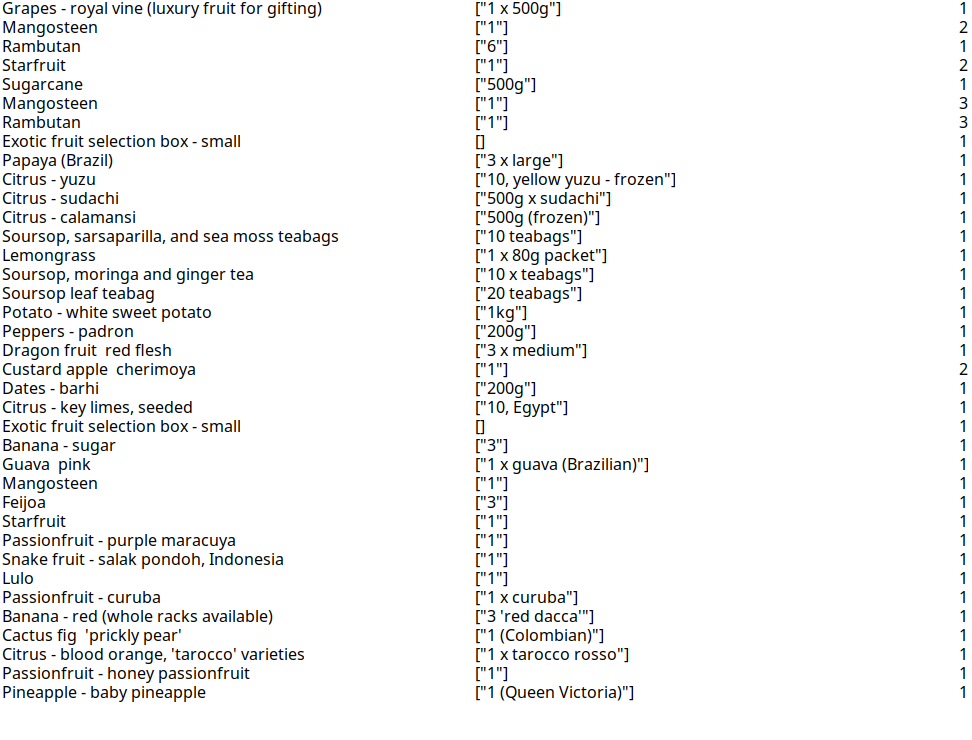
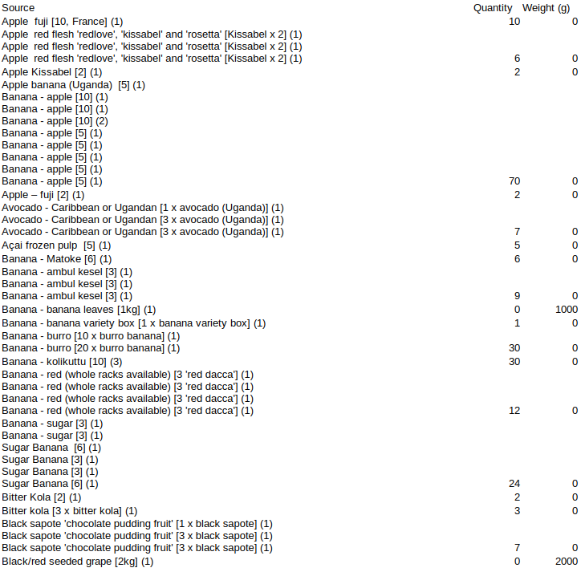

> A recode of https://github.com/scales-dev/Simplify-Product-List
> because paying for Excel is an unnecessary cost.

## Usage

1. Download a Java 21 JRE, I personally recommend [Eclipse Temurin](https://adoptium.net/temurin/releases/?version=21)
2. Download a jar from [releases](https://github.com/scales-dev/Compress-Buying-List/releases)
3. Open your terminal, type "java -jar {drop jar} {drop input.csv}"
4. OUTPUT.csv will appear with the fixed product list!

## About
At work, each day the trade team has to manually simplify a long list of products. eg.

A product can appear twice with slightly varied names, eg.

And this project outputs an easier to read spreadsheet with the quantity and weights of the products. eg.

It tries its best to merge products that are named similar enough, thanks to fuzzywuzzy.
It adds up the totals of each product to save time adding up manually, and sorts alphabetically.