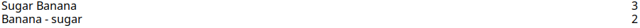

> A recode of https://github.com/scales-dev/Simplify-Product-List
> because paying for Excel is an unnecessary cost.

Written in Java because we use 3 different operating systems across the business, 
and I think Java is easier than Python to write
## Usage
1. Download a Java 21 JRE, I personally recommend [Eclipse Temurin](https://adoptium.net/temurin/releases/?version=21) or [OpenJDK](https://learn.microsoft.com/en-us/java/openjdk/download)
2. Download a .jar release of this project from [Releases](https://github.com/scales-dev/Compress-Buying-List/releases)
3. Open your terminal, type "java -jar {drop jar} {drop input.csv}" as in [this video](https://youtu.be/A-TcEcXLKgI)
4. OUTPUT.csv will appear with the fixed product list!

I'm sure this isn't useful for any other business, this guide is for my boss

## About
At work, each day the trade team has to manually simplify a long list of products. eg.

A product can appear twice with slightly varied names, eg.

And this project outputs an easier to read spreadsheet with the quantity and weights of the products. eg.

It tries its best to merge products that are named similar enough, thanks to fuzzywuzzy.
It adds up the totals of each product to save time adding up manually, and sorts alphabetically.